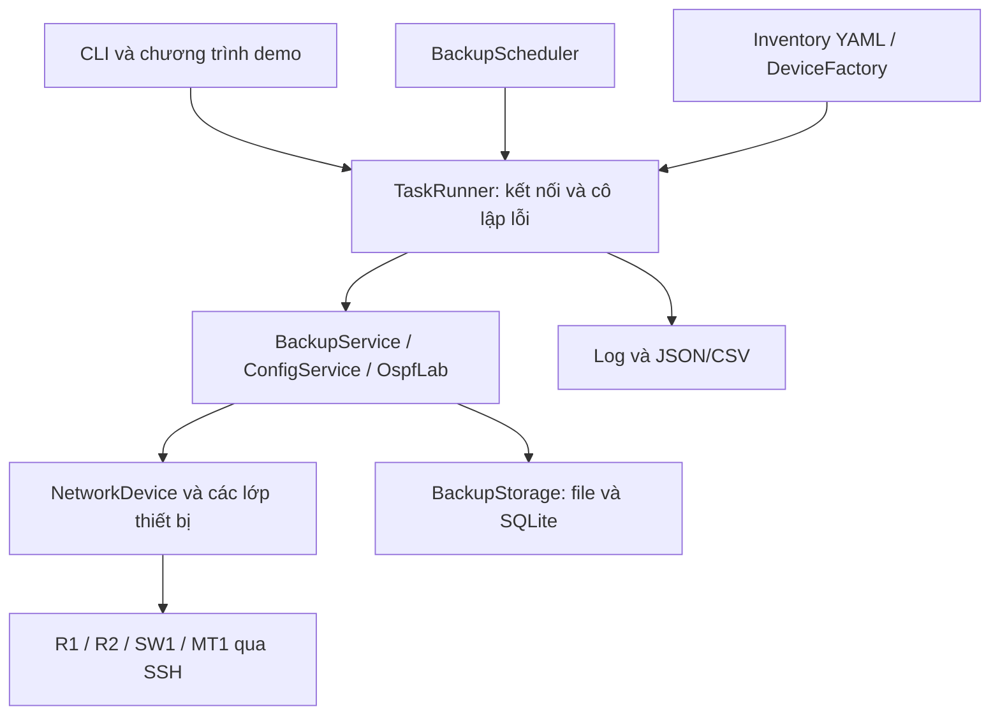
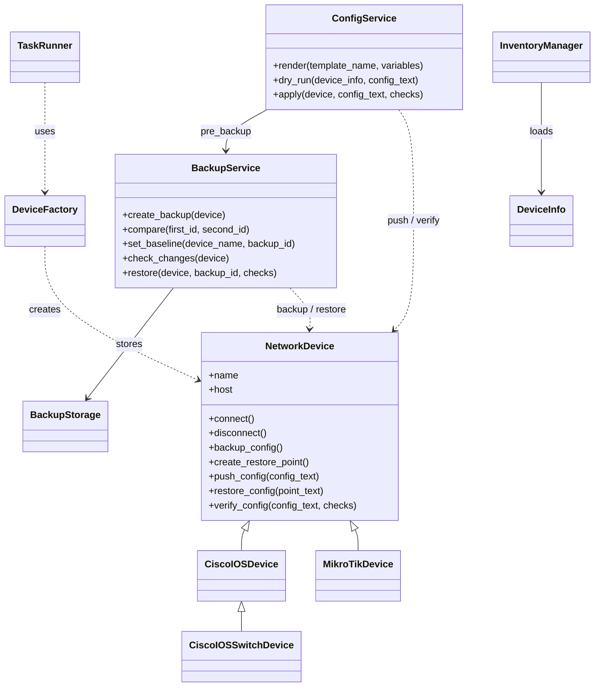
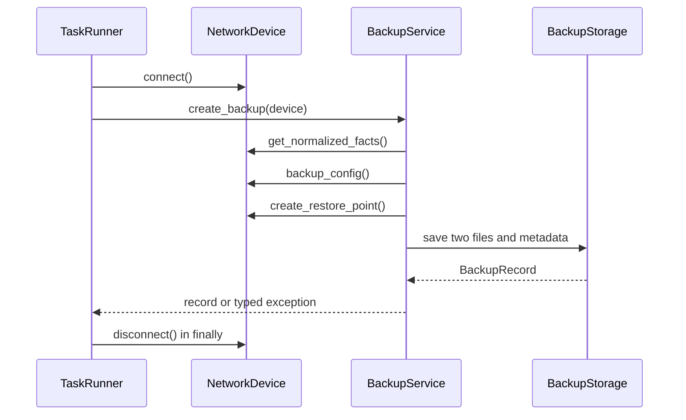
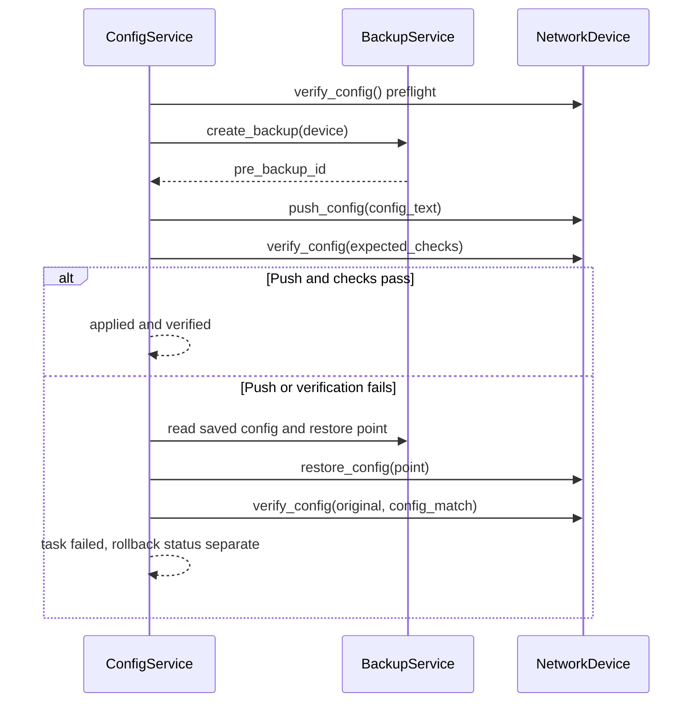

# Tài liệu kỹ thuật cho đội báo cáo

Đây là khung kiến trúc gắn với code, không phải báo cáo nộp đã hoàn tất.
Viết đủ chín mục theo đề; dùng dữ liệu chạy thật trong phần thực nghiệm.
Không chèn toàn bộ mã nguồn vào thân báo cáo. Sơ đồ Mermaid dưới đây có thể
render và xuất ảnh, sau đó đặt chú thích/số hình theo quy cách của nhóm.

## Ánh xạ chín chương

| Mục | Nội dung cần viết và nguồn |
|---|---|
| 1. Giới thiệu | Bài toán backup tập trung, mục tiêu/phạm vi, phân công A/B/C và hai người báo cáo; tỷ lệ đóng góp nhóm tự xác nhận |
| 2. Cơ sở lý thuyết | SSH/CLI và các giao thức khác; so sánh Paramiko/Netmiko/Nornir/NAPALM; lý do chọn Netmiko; dẫn tài liệu gốc |
| 3. Kiến trúc | CLI -> runner/nghiệp vụ -> thiết bị -> file/SQLite, sơ đồ bên dưới |
| 4. OOP | ABC, kế thừa router/switch, đa hình, thuộc tính nội bộ, Factory; sơ đồ lớp |
| 5. Chi tiết | Hai luồng backup và apply/rollback; inventory YAML; env, errors, log, hash, quyền file |
| 6. Môi trường | Hai VM, EVE, bốn thiết bị, topology/IP, phiên bản thực dùng; ảnh T01/T03 |
| 7. Thực nghiệm | T02–T13, kết quả thật, before/after, OSPF, restore và số đo thủ công/tự động |
| 8. Đánh giá | Chức năng đạt theo lab; hạn chế nêu trong CAP_NHAT_V2 và README; không suy ra sản phẩm production |
| 9. Tham khảo/phụ lục | IEEE/APA; inventory mẫu, template OSPF, checks và hướng dẫn chạy; link mã nhóm nếu có |

## Kiến trúc phân lớp

## Sơ đồ lớp rút gọn

Giải thích đóng gói không phải mã hóa: _password/_connection là thuộc tính
nội bộ, .env không vào Git, backup Cisco vẫn cần quyền đọc riêng tư. Lớp
switch kế thừa Cisco để mở rộng VLAN/MAC; B không chứa lệnh riêng từng hãng.

## Luồng 1 — backup theo yêu cầu hoặc lịch

Hai loại dữ liệu phục vụ hai mục đích; native MikroTik không dùng để diff.
File được ghi xong trước commit SQLite. Crash giữa hai tầng có thể để file
mồ côi: không gọi filesystem + SQLite là một giao dịch nguyên tử chung.

## Luồng 2 — apply và rollback đã kiểm chứng

Rollback đã kiểm tra running-config không có nghĩa trạng thái động OSPF đã
hội tụ. Kịch bản OspfLab tách push cả hai khỏi pha đợi neighbor/route/ping;
đọc app/ospf_lab.py và xem báo cáo thực nghiệm để mô tả chính xác.

## Nguồn kỹ thuật gợi ý trích dẫn

- Cisco, Understand Show IP OSPF Neighbor Command Output:
  https://www.cisco.com/c/en/us/support/docs/ip/open-shortest-path-first-ospf/13688-16.html
- Cisco, Configure OSPF with Multi-Area Adjacency (tham khảo output route):
  https://www.cisco.com/c/en/us/support/docs/ip/open-shortest-path-first-ospf/118879-configure-ospf-00.html
- Cisco, Default Passive Interfaces:
  https://www.cisco.com/c/en/us/td/docs/routers/ios-xe/ip-routing/b-ip-routing/m_iri-default-passive-interface.html

Tham khảo thêm tài liệu chính thức của Python, Netmiko, Paramiko, Jinja2,
MikroTik để viết chương lý thuyết. Ghi ngày truy cập thực tế, không bịa tác
giả/ngày xuất bản. Nêu rõ công cụ hỗ trợ và các phần đã tham khảo theo đề.
